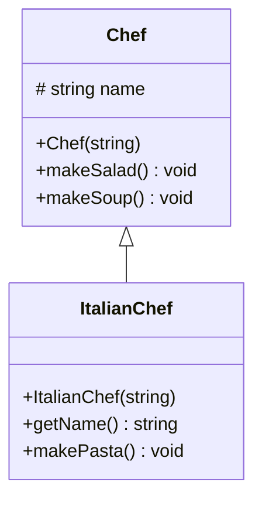

# OAMK

Tässä harjoituksessa toteutettiin C++-ohjelma, jossa harjoiteltiin olio-ohjelmoinnin periytymistä.

Projektissa luotiin kantaluokka `Chef` ja siitä periytyvä aliluokka `ItalianChef`. Luokat toteutettiin UML-kaavion mukaisesti ja niihin lisättiin konstruktorit, destruktorit sekä jäsenfunktiot.

Ohjelma havainnollistaa:

- periytymistä (inheritance)
- kantaluokan konstruktorin kutsumista aliluokasta
- jäsenfunktioiden käyttöä
- olioiden luonti- ja tuhoamisjärjestystä

## Luokat

